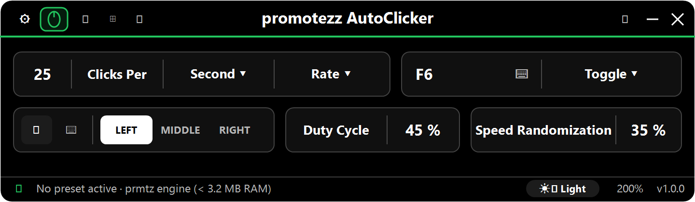

<div align="center">

# promotezz AutoClicker

A high-performance systems auto-clicker engineered for sub-millisecond precision and zero overhead. Built natively in the **Goose programming language** (`aardappel`) with pure high-contrast `#000000` Black and `#ffffff` White themes.

<br />

### Black on White (Light Theme)


<br />

### White on Black (Dark Theme)


<br />

[](https://store.promotezz.cc)
[](https://promotezz.cc)
[](https://store.promotezz.cc)
[](https://github.com/aardappel/goose)
[](https://opensource.org/licenses/MIT)

</div>

---

## Highlights

- ⚡ **Goose Systems Language Core** — Compiled to a single standalone Win32 binary. No Node.js, no Chromium, and zero Webview2 bloat.
- 🪶 **< 3.9 MB RAM** — While Webview2 alternatives consume 100–200 MB, promotezz AutoClicker runs at under 4 MB working set.
- 🌓 **Dynamic Theme Switching** — Toggle instantly between **Black-on-White** (Light) and **White-on-#000000-Black** (Dark) with the footer button or gear icon.
- 🎯 **Accurate Click Rate Engine** — Bare-metal `SendInput` event streaming with sub-millisecond hardware resolution (`timeBeginPeriod(1)`).
- 🖱️ **Multi-Button Support** — Left, Middle, and Right mouse button targeting.
- 🕹️ **Toggle & Hold Modes** — Seamless switching between press-to-toggle and press-and-hold activation.
- ⏱️ **Duty Cycle Calibration** — Adjust active down-time per click cycle (30%, 45%, 60%, 75%).
- 🎲 **Gaussian Speed Randomization** — Box-Muller interval distribution simulates human muscle latency (0%, 15%, 35%, 50%).
- ⌨️ **Configurable Global Hotkey** — Default `F6`, rebindable to `X`, `C`, `V`, or `Mouse 4`.
- 🔔 **Subtle Audio Cues** — Mechanical toggle cues with full mute capability.

---

## Controls

| Control | Description | Interaction |
| :--- | :--- | :--- |
| **Speed Box** | Sets target clicks per second | Left-click to increment / cycle presets, Right-click to decrease |
| **Clicks Per / Unit** | Unit selection | Displays rate in Clicks Per Second |
| **Hotkey Box** | Global activation trigger key | Click to cycle: `F6` → `X` → `C` → `V` → `Mouse 4` |
| **Trigger Dropdown** | Activation behavior | Click to switch between `Toggle ▾` and `Hold ▾` |
| **Button Selector** | Target mouse button | Click `LEFT`, `MIDDLE`, or `RIGHT` |
| **Duty Cycle** | Click hold duration percentage | Click to cycle: `30%` → `45%` → `60%` → `75%` |
| **Speed Randomization** | Interval variance | Click to cycle: `0%` → `15%` → `35%` → `50%` |
| **Theme Toggle** | Theme switcher | Click `☀️ Light` / `🌙 Dark` in footer to toggle |
| **Audio Status** | Sound feedback | Click speaker icon in footer to mute / unmute |
| **Window Controls** | Minimize and Close | Vector-drawn controls in title bar |

---

## Download

Get the standalone executable directly from **[store.promotezz.cc](https://store.promotezz.cc)** or build from source using Goose:

```bash
goose build src/main.goose -o prmtz-autoclicker.exe
```

---

*promotezz · Engineered for peak systems performance*
