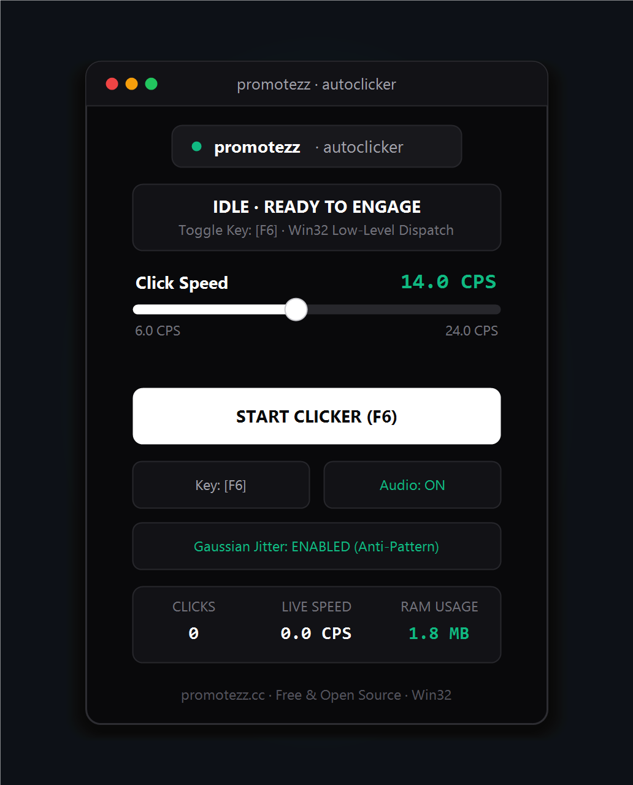

# promotezz autoclicker

A sleek, zero-overhead Win32 autoclicker built for competitive gaming. Runs at under 2 MB RAM with humanized Gaussian click pacing.

 

 

---

## Features

- ⚡ **Sub-Millisecond Win32 Dispatch** — Uses low-level `SendInput` event generation and high-resolution hardware clocks for immediate, lag-free response.
- 🎯 **Smooth 6.0 – 24.0 CPS Control** — Real-time slider lets you dial in the exact speed you want on the fly.
- 🧠 **Humanized Gaussian Jitter** — Natural interval randomization (Box-Muller distribution) prevents static machine click patterns.
- 🪶 **Under 2 MB Memory Footprint** — Extremely lightweight native binary that won't take resources away from your games.
- ⌨️ **Configurable Global Hotkey** — Toggle on and off anywhere with `F6` (or switch to `X`, `C`, `V`, `Mouse 4`).
- 🔔 **Discrete Audio & Dynamic Island LED** — Clean status indicator and optional toggle chime.
- 🛡️ **Zero Setup Required** — Standalone portable `.exe`, no runtimes or background services needed.

---

## How to Use

1. Launch `prmtz-autoclicker.exe`.
2. Set your target click speed with the slider (e.g. `14.0 CPS`).
3. Press **`F6`** (or your selected hotkey) to start or pause clicking.

### Controls

| Action | Control |
| :--- | :--- |
| **Start / Stop** | Press `F6` (or click the main button) |
| **Speed** | Drag slider between `6.0` and `24.0 CPS` |
| **Change Hotkey** | Click key pill to cycle `F6` → `X` → `C` → `V` → `Mouse 4` |
| **Mute Chime** | Click `Audio: ON / MUTE` |
| **Toggle Jitter** | Click `Gaussian Jitter` to switch between humanized and fixed delay |

---

## Download

Get the standalone executable directly from **[store.promotezz.cc](https://store.promotezz.cc)** or the GitHub Releases page.

---

## License

MIT © [promotezz](https://promotezz.cc) — Free & Open Source.
