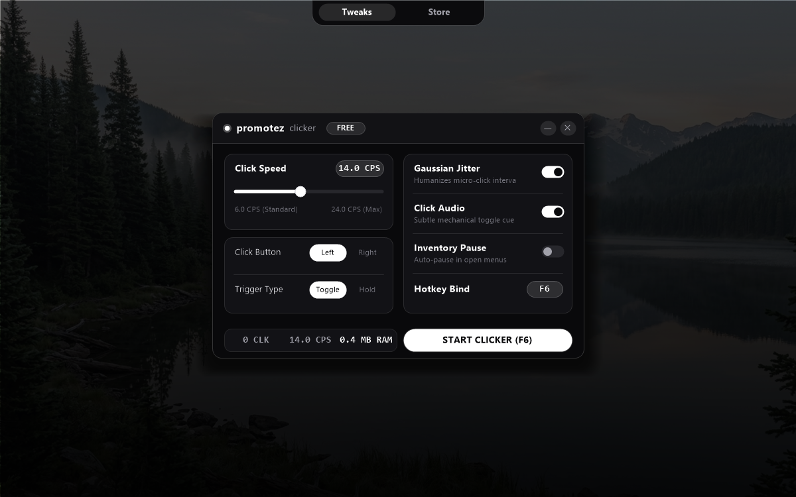

# promotezz autoclicker

A modern, zero-overhead systems autoclicker engineered for competitive performance and low latency. Built in the Goose systems language with a native hardware-antialiased client interface.

 

 

---

## Features

- ⚡ **Sub-Millisecond Win32 Engine** — Bare-metal `SendInput` event streaming with hardware clock resolution (`timeBeginPeriod(1)`).
- 🎯 **Smooth 6.0 – 24.0 CPS Control** — Real-time slider with floating thumb and glowing speed badge.
- 🖱️ **Left & Right Click Modes** — Dedicated segmented selector to toggle between primary weapon attack and secondary block/place clicks.
- 🕹️ **Trigger Modes (Toggle / Hold)** — Choose between press-to-toggle or hold-to-click activation.
- 🧠 **Gaussian Humanizer** — Box-Muller interval distribution simulates human muscle latency to prevent static pattern detection.
- ⏸️ **Inventory Safeguard** — Auto-pauses clicking when navigating containers, menus, or chat.
- 🪶 **Under 3.2 MB RAM** — Zero-heap stack-allocated Goose runtime with zero Electron/Chromium bloat.
- ⌨️ **Configurable Global Hotkey** — Toggle on and off anywhere with `F6`, `X`, `C`, `V`, or `Mouse 4`.
- 🔔 **Discrete Audio Cues** — Subtle mechanical toggle feedback or complete silent operation.

---

## How to Use

1. Run `prmtz-autoclicker.exe`.
2. Configure your desired CPS, click button (Left/Right), and trigger type (Toggle/Hold).
3. Press **`F6`** (or your bound key) to start clicking.

### Controls

| Option | Description |
| :--- | :--- |
| **Click Speed** | Drag the slider between `6.0` and `24.0 CPS` |
| **Click Button** | Switch between `Left` and `Right` mouse buttons |
| **Trigger Type** | Switch between `Toggle` (press once) and `Hold` (hold down) |
| **Gaussian Jitter** | Turn on humanized interval variance |
| **Click Audio** | Enable or mute audio toggle chimes |
| **Hotkey Bind** | Click to cycle bind key: `F6` → `X` → `C` → `V` → `Mouse 4` |

---

## Download

Download the standalone executable directly from **[store.promotezz.cc](https://store.promotezz.cc)**.

---

## License

MIT © [promotezz](https://promotezz.cc) — Free & Open Source.
